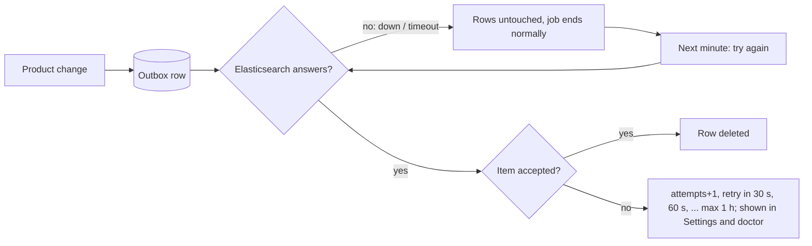
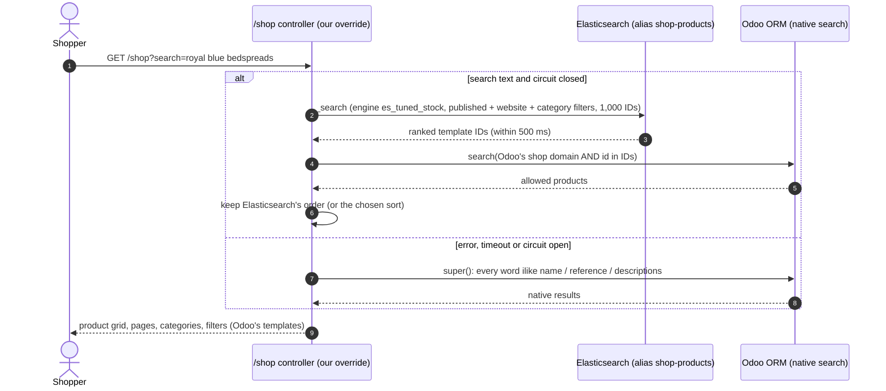

# Figures: diagrams and screenshots

Diagrams are kept as Mermaid sources (they render on GitHub and export to SVG/PNG with any Mermaid tool), so a
figure changes with the code it shows. Screenshots are listed with what they must show; capture them on the
labelled synthetic catalog and never with personal data. Earlier lists: [M1](../notes/M1.md),
[M2](../notes/M2.md) ("Screenshots to capture").

## D1 — Incremental product sync (Task 3.2, FR1)

```mermaid
sequenceDiagram
    autonumber
    actor M as Manager / shopper
    participant O as Odoo (request)
    participant DB as PostgreSQL
    participant C as Cron worker
    participant ES as Elasticsearch (alias shop-products)
    M->>O: change price / stock / publish (or a sale reserves stock)
    O->>O: hook after super(): _enqueue(template id)
    O->>DB: pre-commit: INSERT outbox row + ir.cron.trigger
    O->>DB: COMMIT (change and row together)
    DB-->>C: NOTIFY cron_trigger (after commit)
    C->>DB: lock rows (FOR UPDATE SKIP LOCKED), merge per product
    C->>DB: read products as they are now (free_qty, published, ...)
    C->>ES: _bulk?require_alias=true (index / delete)
    ES-->>C: per-item result
    C->>DB: delete sent rows; refused rows: retry later (backoff)
    Note over ES: searchable after the 1 s refresh
```

## D2 — Rebuild and sync never overlap (Task 3.2)

```mermaid
sequenceDiagram
    participant R as Rebuild (button or CLI)
    participant L as PostgreSQL advisory lock
    participant S as Sync job
    participant ES as Elasticsearch
    R->>L: take lock (own cursor; waits for a running sync batch)
    R->>R: open a NEW reading cursor (snapshot after the lock)
    S->>L: try lock: busy -> skip, rows wait
    R->>ES: load shop-products-v(N+1), count check, swap alias
    R->>L: release; make waiting rows due; trigger the sync
    S->>ES: send rows enqueued during the rebuild into the new index
```

## D3 — Outage (Task 3.2, reliability §13)



## D4 — Shop search with fallback (Task 3.3, FR2–FR3, reliability §13)



## Screenshots to capture — M3

| # | Screen | What it must show | State |
|---|---|---|---|
| S3.1 | Odoo › Settings › Website › Lost-demand search | "Product index: In sync", index `shop-products-v5`, 19,869 / 19,869; "Product changes: Up to date" | to capture |
| S3.2 | Same block, Elasticsearch stopped, after a price change | "Unreachable", "1 product changes waiting" | to capture |
| S3.3 | Odoo › Settings › Technical › Scheduled Actions | "Lost-demand search: sync product changes to Elasticsearch", every 1 minute | to capture |
| S3.4 | Terminal | `uv run shop probe products` output with p50/p95/max | to capture |
| S3.5 | Kibana › Discover (or Dev Tools, read-only) | one product document before and after a stock change (`free_qty`, `in_stock`) | to capture |
| S3.6 | Terminal | `uv run shop index rebuild`: "moved from shop-products-v4", count OK | to capture |
| S3.7 | Shop › `/shop?search=royal blue bedspreads` | results found by Elasticsearch (Odoo's own search finds none for the plural, baseline screenshot 3) | to capture |
| S3.8 | Shop › `/shop?search=theottle cable` | throttle cables despite the typo, with the category list | to capture |
| S3.9 | Shop, Elasticsearch stopped | same search still answers (Odoo's results), no error page | to capture |
| S3.10 | Terminal | `uv run shop eval ndcg --engine all --mode both`: progress, per-engine NDCG@10 with intervals, Holm p-values | to capture |
| S3.11 | `results/summary/ndcg-dev-both.md` (rendered) | the generated dev table with the consistency section | to capture |
